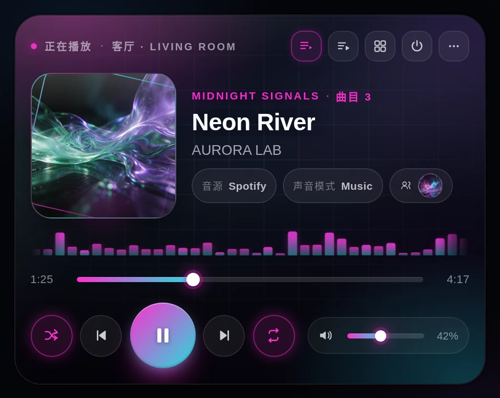
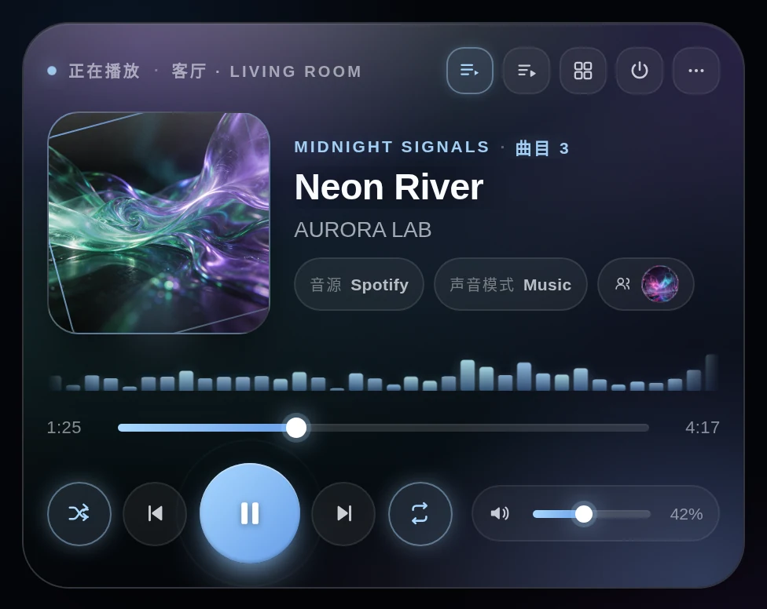
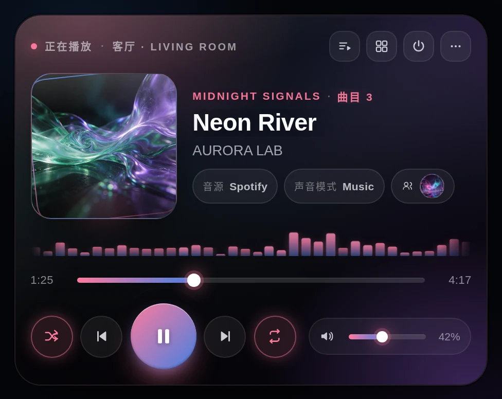
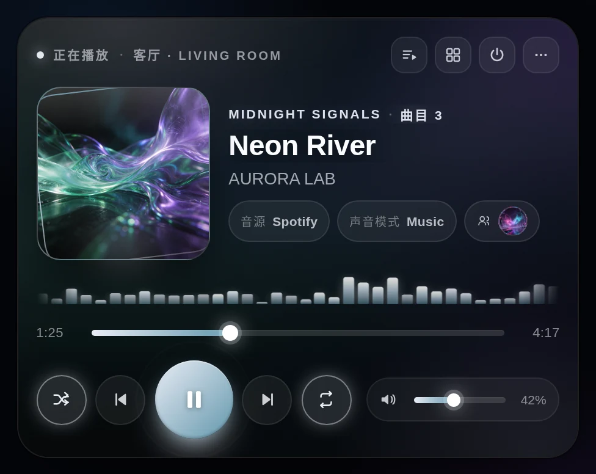
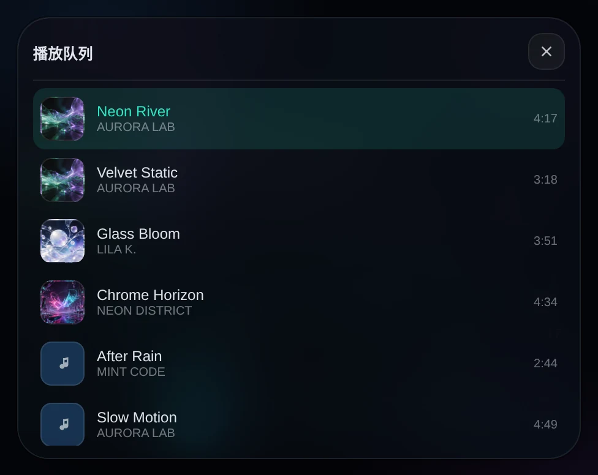
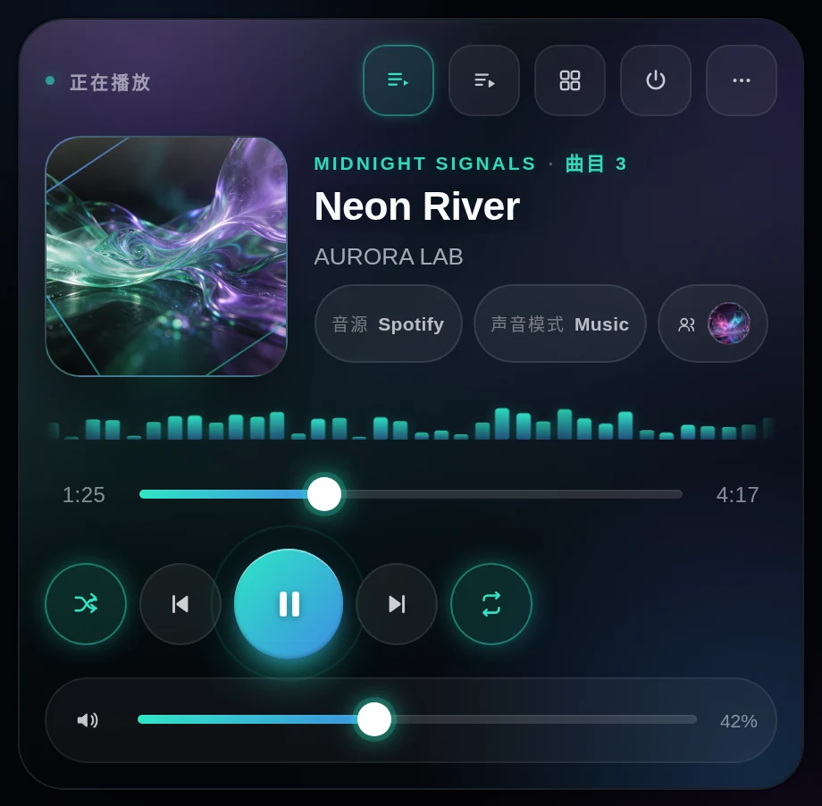
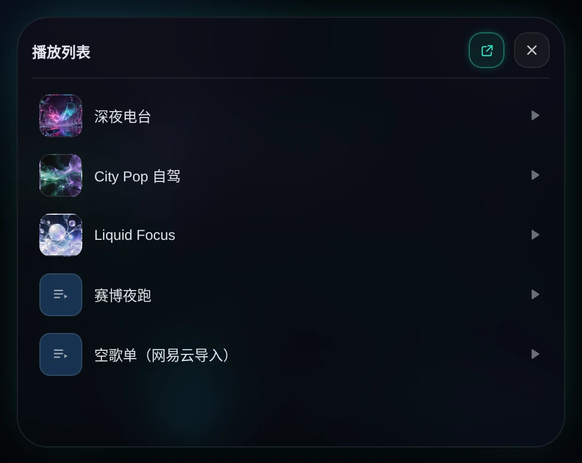

# HA Music

> 为 Home Assistant 打造的高颜值、全功能音乐播放器 Lovelace 卡片。<br>
> 液态玻璃 / 赛博霓虹 / 极光 / 天鹅绒 / 黑白 / 日落 / 海洋 七套主题，三种自适应布局，从封面取色的动态氛围光。

[](https://github.com/RockJesus/ha-music/releases)
[](https://hacs.xyz)
[](LICENSE)


---

## 特性

- **全局统一**：顶部、侧边栏、右下角三个迷你播放器的开关、实体和主题写入浏览器 localStorage，在 `test`、`music` 等不同视图/仪表盘之间保持同一组配置。
- **七套主题**：`aurora` 极光、`cyber` 赛博朋克、`liquid` 液态玻璃、`velvet` 天鹅绒、`mono` 黑白、`sunset` 日落、`ocean` 海洋；顶部、侧边栏、右下角三个迷你播放器可分别选择主题。
- **栅格自适应**：实现 `getGridOptions()` / `getLayoutOptions()`，支持 sections 视图调整列数与行数（最低 4 列×2 行）；卡片高度跟随网格行高填满，不再出现下方空白。
- **宽高双维自适应**：除宽度外同时检测卡片可用高度，矮格子自动降到 mini 单行、低矮中等格子用 compact，避免封面/标题/控制条被裁切。
- **元素不互相遮盖**：封面尺寸随可用高度计算，控制区强制单行、不再让音量换行；紧凑矮卡片自动隐藏频谱和封面光晕，保证标题、进度、控制条各占独立区域。
- **卡片选择器缩略预览**：`hui-card-preview` 内使用独立的参考图 UI——圆角方形封面、大标题、频谱、进度条和完整控制条；按预览尺寸分 lg / md / sm 三档，缩略图不再复用仪表盘布局。
- **三档自适应布局**：`full` 完整、`compact` 紧凑、`mini` 迷你单行；默认 `adaptive` 按卡片宽度自动切换（< 430px 进入 compact）。
- **封面驱动配色**：从当前封面提取主色，混入次色与背景氛围光；跨域或取色失败时回退到主题色。
- **面板单屏铺满**：面板视图按可用高度约束圆形封面，自动压缩主区，频谱、进度和控制条保持在单屏内，不产生纵向溢出。
- **圆形旋转封面**：主卡片和全局迷你播放器的歌曲封面统一为圆形；播放时顺时针旋转，暂停时平滑回正。
- **三种背景模式**：`ambient` 环境模糊、`art` 封面铺满、`palette` 纯色彩、`none` 无背景。
- **频谱动效**：`bars` 柱状、`wave` 波形、`orbit` 光环；以「歌名+歌手+专辑」作为曲目种子，用 `media_position` 驱动低频脉冲，播放时随进度起伏、暂停时冻结。属于程序化伪频谱，不读取真实音频采样。
- **完整播放控制**：播放/暂停、上一首/下一首、进度拖动、音量拖动与静音、随机、循环（关/列表/单曲）、电源开关。
- **音源与声音模式**：读取 `source_list` / `sound_mode_list`，点击 chip 直接切换。
- **播放队列**：读取播放器 `queue` 属性，抽屉内点击任意曲目跳播。
- **媒体库浏览**：走 HA 原生 WebSocket `media_player/browse_media`，支持逐层进入、返回与播放叶子项。
- **多设备切换**：`entities` 列表顶部胶囊切换，同一张卡管理多个 `media_player`。
- **触屏优先**：`pointer: coarse` 下按钮/滑杆/列表自动放大到 40–48px，抽屉滚动不穿透页面，点按有按压反馈；窄屏自动把音量条换到下一行，避免大按钮把卡片撑破。
- **Music Assistant 歌单**：顶栏歌单按钮直接列出 MA 播放列表，点击任意歌单即通过 `music_assistant.play_media` 开播；按钮只在当前播放器是 MA 播放器时出现，普通播放器会提示先切换，不再发出无效请求；抽屉右上角仍可跳转 MA 面板。
- **能力自适应**：按 `supported_features` 位掩码显示按钮，不出现无效控件。
- **可视化编辑器**：UI 内直接改布局、主题、背景、频谱、标题、强调色、音量实体与显示开关。
- **无 CDN 依赖**：单文件 ESM，内联全部依赖与图标，离线可用。

## 预览

| 极光 Aurora | 赛博朋克 Cyberpunk |
| --- | --- |
|  |  |

| 液态玻璃 Liquid Glass | 天鹅绒 Velvet | 黑白 Mono |
| --- | --- | --- |
|  |  |  |

| 紧凑布局 | 迷你布局 |
| --- | --- |
|  |  |

| 播放队列 | 媒体库 |
| --- | --- |
|  |  |

| 手机触屏（完整） | 手机触屏（紧凑 / 迷你） |
| --- | --- |
|  |  |

| Music Assistant 歌单 | 空歌单提示 |
| --- | --- |
|  |  |

## 安装

### HACS（推荐）

1. HACS → 右上角菜单 → **Custom repositories**。
2. Repository 填 `https://github.com/RockJesus/ha-music`，Category 选 **Lovelace / Dashboard**，点击 Add。
3. 在 HACS 中搜索 **HA Music** 并下载。
4. 刷新浏览器（必要时清缓存），HACS 会自动注册资源。

### 手动安装

1. 下载 [最新 Release](https://github.com/RockJesus/ha-music/releases/latest) 中的 `ha-music.js`。
2. 放到 `/config/www/ha-music.js`。
3. 设置 → 仪表盘 → 右上角菜单 → 资源，添加：
   - URL：`/local/ha-music.js?v=1.3.10`
   - 类型：JavaScript 模块

## 配置

```yaml
type: custom:ha-music
entity: media_player.living_room
```

| 配置项 | 类型 | 默认 | 说明 |
| --- | --- | --- | --- |
| `entity` | string | — | 单个 `media_player` 实体；与 `entities` 二选一 |
| `entities` | list | — | 多个播放器，卡片顶部显示切换胶囊 |
| `name` | string | 实体名称 | 状态栏显示的播放器名称 |
| `layout` | `adaptive` \| `full` \| `compact` \| `mini` | `adaptive` | 布局；`adaptive` 按宽度自动切换 |
| `theme` | `aurora` \| `cyber` \| `liquid` \| `velvet` \| `mono` \| `sunset` \| `ocean` | `aurora` | 主卡片主题 |
| `accent` | hex color | — | 覆盖主题主色，如 `"#ff5fa2"` |
| `palette` | bool | `true` | 是否从封面取色（`false` 则固定主题色） |
| `cover` | `ambient` \| `art` \| `palette` \| `none` | `ambient` | 背景模式 |
| `visualizer` | `bars` \| `wave` \| `orbit` \| `none` | `bars` | 频谱动效 |
| `volume_entity` | string | — | 用独立实体控制音量（如 `media_player.amplifier`） |
| `show_volume` | bool | `true` | 显示音量条 |
| `show_source` | bool | `true` | 显示音源 chip |
| `show_queue` | bool | `true` | 显示队列按钮（需播放器提供 `queue` 属性） |
| `show_library` | bool | `true` | 显示媒体库按钮（需支持 `BROWSE_MEDIA`） |
| `show_group` | bool | `true` | 显示分组标签与分组成员 |
| `dock` | `none` \| 位置数组 | `none` | 全局迷你播放器位置，可同时启用多个：`top` / `sidebar` / `fab`；直接控制播放暂停、上一首、下一首，不跳转页面 |
| `dock_entities` | object | — | 每个位置各自的播放器实体，如 `{ top: "media_player.a", sidebar: "media_player.b", fab: "media_player.c" }`；未填时回退主卡片实体 |
| `dock_themes` | object | — | 每个位置各自的播放器主题，如 `{ top: "cyber", sidebar: "liquid", fab: "velvet" }`；未填时跟随主卡片 `theme` |
| `max_queue` | number | `60` | 队列最多展示条数 |
| `music_assistant` | `true` \| `false` \| string | 自动 | 歌单入口：不填时检测到 MA 服务/播放器即显示；`false` 隐藏；字符串同时作为抽屉内「打开 MA」按钮的面板地址（留空自动读 HA 面板路径） |

### 全局迷你播放器

在任意 `ha-music` 卡片的可视化编辑器里，**顶部播放器 / 侧边栏播放器 / 右下角播放器** 可以同时启用，也可以分别选择各自的播放器实体。不是跳转按钮，播放/暂停、上一首、下一首会直接调用对应 `media_player` 的服务。

- **顶部**：嵌入 HA 顶栏，高度随顶栏自适应；宽度在桌面/手机自动收敛，**默认在顶栏「+」按钮左侧**，长按后**只允许左右移动**，并始终夹在顶栏内。
- **侧边栏**：宽度贴合当前侧栏宽度；**默认在侧边栏「设置」入口上方**，长按后**只允许上下移动**，X 固定在侧栏内，不进入主内容区；侧栏折叠时自动缩成紧凑圆盘。
- **右下角**：**默认在屏幕右侧垂直居中**的圆形唱片；长按约 0.36 秒后可**任意拖动**，但位置会被约束在主内容区，不能进入顶部导航栏或侧边栏。点击展开为玻璃面板，显示封面模糊背景、曲目信息、进度和播放控制。收起态外圈带 **36 根镜像音频律动柱**（12 点低频紫、6 点高频青），随歌曲元数据与 `media_position` 起伏，并叠加唱片脉冲与紫色辉光；暂停或展开时淡出。参考 `rockjesus.cn` 左下角播放器的 `rj-pl-eq`。
- **交互**：单击任意非按钮区域切换播放/暂停；双击折叠或展开；顶部/侧边栏/右下角都支持长按约 0.36 秒后拖动位置，其中顶部只左右、侧边栏只上下、右下角可任意拖动但避开顶栏与侧栏。顶部/侧边栏双击折叠成小圆盘，右下角双击展开或收起玻璃面板；上一首、下一首、音量等按钮仍保留各自动作。
- 卡片渲染一次后，位置、当前播放器实体和拖动坐标记入浏览器 `localStorage`；之后打开其他仪表盘会自动恢复，不需要每个页面都放卡。
- 也可以直接用资源 URL 指定：`&dock=top,fab&dock_entity_top=media_player.a&dock_entity_fab=media_player.b&dock_theme_top=cyber&dock_theme_fab=velvet`；`dock` 可选 `top` / `sidebar` / `fab`，多个用逗号分隔。
- 编辑器里每个已启用的位置都有独立「播放器主题」下拉，可选 `aurora` / `cyber` / `liquid` / `velvet` / `mono` / `sunset` / `ocean`；未显式选择时跟随主卡片主题。
- 关闭：在编辑器里取消对应位置的勾选；全部关闭即移除全局播放器。
- 同一个 `ha-music.js` 既可作为 Lovelace 资源，也可作为全局模块加载；内部已防止重复 `customElements.define`。
- 需要设置页等非仪表盘页面也加载时，再把模块地址加入 `frontend.extra_module_url`（可选）。

### 面板自适应

当卡片放在 HA 的面板视图（view `type: panel`）里时，会自动检测 `hui-panel-view` 并铺满面板可用宽高；普通 masonry/sections 视图仍按卡片内容高度渲染。

### 示例

**基础**

```yaml
type: custom:ha-music
entity: media_player.living_room
theme: aurora
```

**液态玻璃 + 封面铺满 + 波形**

```yaml
type: custom:ha-music
entity: media_player.study
theme: liquid
cover: art
visualizer: wave
accent: "#a9d8ff"
```

**多设备 + 迷你布局**

```yaml
type: custom:ha-music
entities:
  - media_player.living_room
  - media_player.bedroom
  - media_player.kitchen
layout: mini
theme: cyber
show_volume: false
```

### Music Assistant

- 顶栏歌单按钮列出 MA 播放列表（走 `media_player/browse_media` 的 `Playlists` 目录），点击后调用 `music_assistant.play_media`（`media_type: playlist`、`enqueue: play`）直接开播。
- 没有 MA 服务时自动回退 `media_player.play_media`，因此普通播放器的歌单也能用。
- 抽屉右上角的跳转图标打开 MA 面板：默认自动读取 HA 面板路径（加载项 ingress 的前缀因实例而异，如 `/b93b5321_music_assistant`），也可用 `music_assistant` 指定相对路径或 `https://` 地址。
- 队列与媒体库浏览仍走实体暴露的 `queue` 与 `browse_media`，无需额外配置。

## 交互说明

- **点击封面 / 右下角菜单** → 打开更多信息（more-info）。
- **进度条**：拖动时显示预览时间，松手后调用 `media_seek`。
- **音量条**：拖动实时调音量，松手调用 `volume_set`；喇叭图标切换静音。
- **音源 / 声音模式 chip**：点击弹出列表，选中即切换。
- **队列抽屉**：点击曲目通过 `media_content_id` / `media_content_type` 播放。
- **媒体库抽屉**：逐层进入，左上角返回上一级。
- **分组标签**：点击即退出当前分组。

## 兼容性

- Home Assistant 2023.8 及以上；不需要任何前端集成或后端组件。
- 队列依赖播放器暴露 `queue` 属性（Music Assistant、Sonos 等支持）。
- 媒体库依赖播放器支持 `BROWSE_MEDIA`，部分集成可能只返回扁平列表。
- 音量默认作用于当前播放器，可用 `volume_entity` 指向功放/音箱实体。

## 开发

```bash
cd card-src
npm install
npm test      # 工具函数单元测试
npm run build # 输出 ../ha-music.js
```

预览页面 `preview/preview.html` 内置伪 hass / 队列 / 媒体库，可脱离 HA 直接查看效果：

```bash
python3 -m http.server 8765
# http://localhost:8765/preview/preview.html?theme=cyber&layout=full&w=460
```

## 更新日志

- **1.3.10**：修复 HA 2026.6 新卡片选择器缩略预览不生效：兼容 `hui-suggestion-card` 与 `hui-card[preview]`，并读取卡片自身的 `preview` 属性；窄高预览卡片按 md/sm 自适应，保留圆角方形封面、大标题、频谱、进度和控制条。
- **1.3.9**：新增卡片选择器缩略预览专用 UI，参考圆角方形封面、大标题与完整控制条；按预览尺寸分 lg / md / sm 三档自适应。仅作用于预览容器，不影响仪表盘卡片与迷你播放器。

- **1.3.8**：修复各尺寸元素互相遮盖：封面尺寸按卡片高度动态收缩；控制条禁止换行，音量收窄；紧凑矮卡片隐藏频谱与封面光晕并收紧内边距。

- **1.3.7**：自适应布局改为同时按宽度和高度判断：6 列×2 行等矮格子自动切 mini 单行，6 列×4 行等低矮格子切 compact，12 列×6 行恢复 full；最小栅格宽度放宽到 4 列。

- **1.3.6**：实现 sections 栅格尺寸接口 `getGridOptions` / `getLayoutOptions`，消除「调整大小支持不完整」警告；卡片主机与 `.hm-card` 高度改为 100%，在网格单元格内自动填满，配合全宽/按内容高度使用。

- **1.3.5**：三个迷你播放器改为全局配置：开关、实体、主题跨仪表盘/视图统一；旧页面里的 `dock: none` 不再清除其他页面已启用的全局播放器。

- **1.3.4**：修复三个迷你播放器开关全部关闭后仍会被旧 localStorage 记录重新装回的问题；显式 `dock: none` 现在会同步清除旧的三位置记忆。

- **1.3.3**：调整三个迷你播放器的默认位置：顶部默认在顶栏「+」按钮左侧，侧边栏默认在「设置」入口上方，右下角默认在屏幕右侧垂直居中；已拖动保存过的位置仍优先生效。

- **1.3.2**：新增 `sunset` 日落与 `ocean` 海洋两套主题；顶部、侧边栏、右下角三个迷你播放器支持在编辑器中分别选择主题（`dock_themes`），每个位置独立持久化，并跟随各自的播放器实例渲染。

- **1.3.1**：顶部播放器宽度从 330px 收到 300px（窄屏最低 200px），减少顶栏占用；内部封面/标题/控制按钮尺寸不变。

- **1.3.0**：封面统一强制圆形裁剪（`border-radius:50%` + `clip-path:circle`），即使封面图本身是正方形、带白底/透明角，也不会露出方形边角；顶部、侧栏、右下角三种播放器同步生效。

- **1.2.9**：修复长按拖动右下角播放器时封面图片被浏览器原生拖拽、播放器不跟随鼠标的问题；封面 img 禁用原生拖拽并加 `dragstart` 拦截，拖动恢复为整卡跟随鼠标。

- **1.2.8**：右下角播放器支持长按拖动，可移动到主内容区的任意位置并记住坐标；拖动时自动避开 HA 顶栏与侧边栏，侧栏展开/折叠后也会重新夹紧，不进入这两个区域。

- **1.2.7**：侧边栏折叠成窄轨时，播放器通过 ResizeObserver 自动跟随并切换紧凑圆形 UI；紧凑尺寸按侧栏实际宽度计算（52px / 40–56px），不再横跨主内容区；侧栏重新展开后自动恢复完整横向布局。

- **1.2.6**：顶部播放器改为识别 HA 的 `ha-top-app-bar-fixed / .top-app-bar`，真正贴入顶部导航栏，不再误用仪表盘视图 `.header`；顶部胶囊缩到 330×44（窄屏自适应），封面 30、控制按钮 24–28，内部标题/副标题/控件不再互相遮挡。

- **1.2.5**：顶部播放器嵌入 HA 顶栏并只允许左右移动；侧边栏播放器贴合侧栏宽度、只允许上下移动且不越出侧栏；右下角播放器固定，不再响应拖动；折叠侧栏自动紧凑。

### 1.1.6

- 窄面板（≤620px）改为封面+信息双列、控制栏单行，避免小屏面板内容过高被裁切。

### 1.1.5

- 面板视图（`type: panel`）自动识别 `hui-panel-view`，卡片铺满可用宽高，去掉圆角与 760px 内容宽度限制；窄面板自动切单列。

### 1.1.4

- 迷你播放器的播放/暂停按钮改为圆角方形，不用圆形元素。

### 1.1.3

- 迷你播放器副标题去掉与歌名重复的歌手名；封面地址异常时回退音符图标。

### 1.1.2

- 全局入口改为迷你播放器：可选顶部 / 侧边栏 / 右下角，直接控制播放/暂停、上一首、下一首，不再跳转页面。
- 编辑器改为位置下拉；位置与当前播放器实体记忆到 localStorage，所有仪表盘加载后自动出现。
- 移动端三种位置自动全宽；触屏按钮保持 28–34px。
- 单测 11/11、卡片 62/62、编辑器 46/46 通过。

### 1.1.1

- 顶部悬浮胶囊改为右上角、位于 HA 顶栏下方空白区，避免遮挡仪表盘标签与标题。

### 1.1.0

- 顶部悬浮胶囊上移到 HA 顶栏内（`safe-area + 9px`），不再遮挡仪表盘标签栏；移动端同步上移。

### 1.0.9

- 新增全局入口：顶部悬浮胶囊 + 右下角悬浮按钮，点击进入独立播放器仪表盘；进入播放器路径后自动隐藏。
- 卡片新增 `dock` / `dock_path` 配置，编辑器新增「全局悬浮入口」开关；也支持模块 URL `?dock=1&dock_path=...` 作为 `frontend.extra_module_url` 全局加载。
- 同一份 bundle 可同时作为 Lovelace 资源和全局模块加载，已加 `customElements` 重复注册保护。
- 新增侧边栏播放器仪表盘入口（`HA Music Player`，`/ha-music-player`）。
- 体检：卡片 62/62、编辑器 45/45 全部通过；单测 11/11 通过。

### 1.0.8

- 三种频谱统一改为「曲目种子 + 播放进度」驱动：种子取「歌名+歌手+专辑」，同一首歌图案稳定，切歌才换形；`media_position` 换算成低频脉冲，播放时起伏、暂停时冻结。
- `bars` 低频段随脉冲抬高、高频段反应减弱，柱高过渡更平滑；`wave` 三层波形振幅随低频/脉冲变化，滚动速度跟随曲目节奏；`orbit` 光圈亮度、描边宽度与光晕随脉冲增强，内圈优先响应低频。
- 播放中刷新间隔从 1s 提到 500ms，脉冲更连续；首次只注入 `hass` 后 `setConfig` 现在会立即启动计时器。
- 新增 `visualizerFrame` 纯函数与 2 条单测，当前单测 11/11 通过。

### 1.0.7

- 顶栏 MA 歌单按钮只在当前播放器是 Music Assistant 播放器时显示；普通播放器隐藏按钮，误触时提示切换到 MA 播放器，不再发出无效的 `music_assistant.play_media` 请求。
- `_openPlaylists()` 与 `_playPlaylistItem()` 增加前置校验，非 MA 播放器不发服务调用。
- 中英文文案补齐 `maPlayerRequired`。

### 1.0.6

- 可视化编辑器：关闭 MA 歌单开关后再打开，会保留之前填写的 MA 面板地址，不再被重置成 `true`。
- 编辑器输入框统一 40–46px 高、开关整行可点（不再只能点小复选框），触屏下开关行 48px、复选框 24px。
- 新增 `preview/editor-audit.html`：对编辑器 44 项做端到端校验（初始回显、4 个下拉选项数、标题/颜色/取色、音量实体、6 个显示开关、MA 地址、增删设备、切换设备、配置无 undefined 泄漏）。

### 1.0.5

- 触屏优化：粗指针设备下图标按钮 40px、传输按钮 46px、播放键 58px 起，进度/音量滑杆触摸高度 40px、滑块 19px。
- 抽屉列表行高 60px，点击有按压反馈；抽屉滚动 `overscroll-behavior: contain`，不再带着整页一起滚。
- 手机宽度自动隐藏播放器名，状态文字不再被按钮挤成「正在…」。
- 窄屏（≤470px）控制区自动换行、音量条独占一行，修复大按钮导致的横向溢出。
- 菜单加最大高度与内部滚动；`Esc` 可关闭抽屉与音源菜单。
- 修复点开「音源 / 声音模式」菜单瞬间被卡片外层点击逻辑关掉的问题。
- 无 `SEEK` 能力的播放器不再响应进度条拖动。
- 新增 `preview/audit.html` 自动化体检：主题/布局/背景/频谱/开关项/多设备/播放控制/抽屉/编辑器共 62 项，桌面与触屏均全绿。

### 1.0.4

- 歌单在 MA 中为空时不再弹出原始英文报错，改为可读提示并置灰标记该歌单，避免重复两次错误弹窗。
- 空歌单失败后不再盲目回退 `media_player.play_media`（同一原因必然再失败）。

### 1.0.3

- 顶栏 `MA` 跳转按钮改为 **Music Assistant 歌单选择器**：列出播放列表，点击即开播（`music_assistant.play_media`）。
- 非 MA 播放器自动回退到 `media_player.play_media`。
- 抽屉右上角保留「打开 MA 面板」快捷入口，面板路径仍自动读取。
- 歌单抽屉新增封面/无封面占位、空列表与错误提示。

### 1.0.2

- 自动从 `hass.panels` 定位 Music Assistant 面板路径，兼容加载项 ingress 的随机前缀，不再依赖固定 `/music-assistant`。
- 保留 `music_assistant` 自定义路径/`false` 关闭的能力。

### 1.0.1

- 新增 Music Assistant 入口：自动识别 MA 播放器，顶栏 `MA` 徽标一键跳转 MA 面板。
- 支持 `music_assistant: true / false / "自定义地址"`，兼容加载项 ingress 路径与外部地址。
- 编辑器新增入口开关与地址输入。
- 预览截图同步刷新。

### 1.0.0

- 首个版本：五主题、三布局、封面取色、三种频谱、队列与媒体库抽屉、多设备切换、可视化编辑器。

## License

[MIT](LICENSE)
