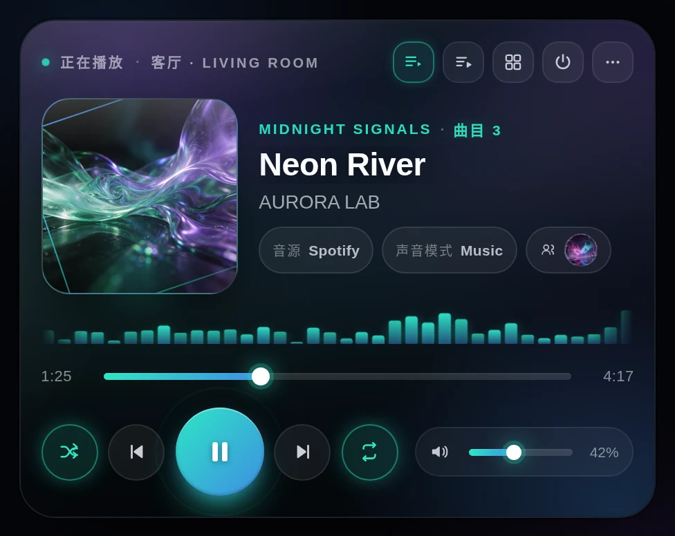
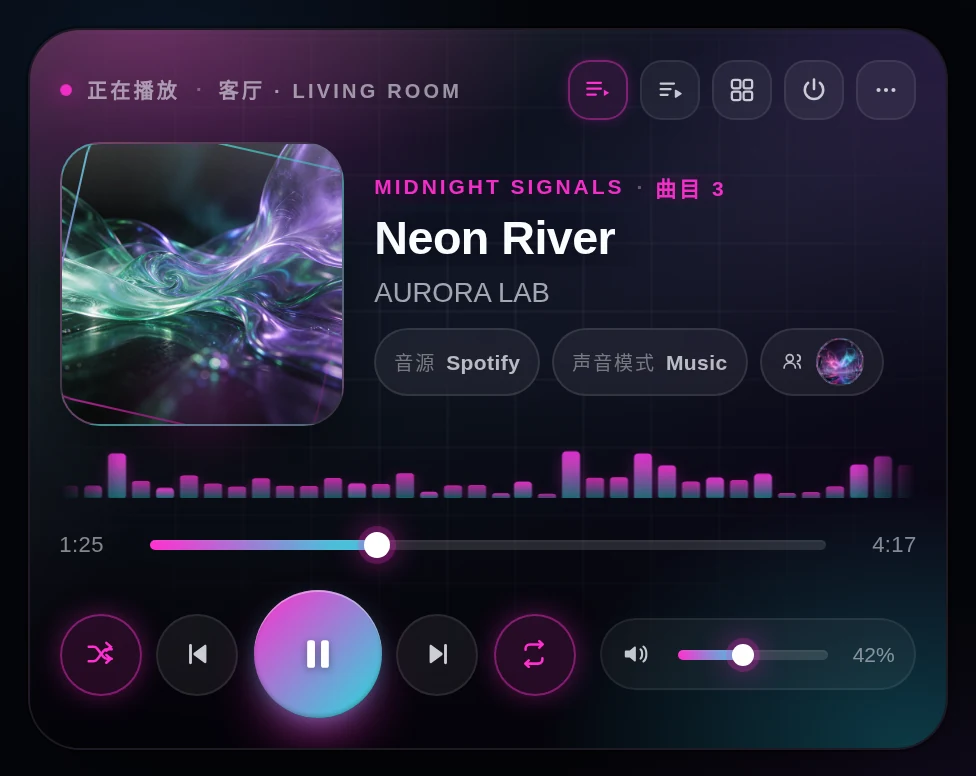
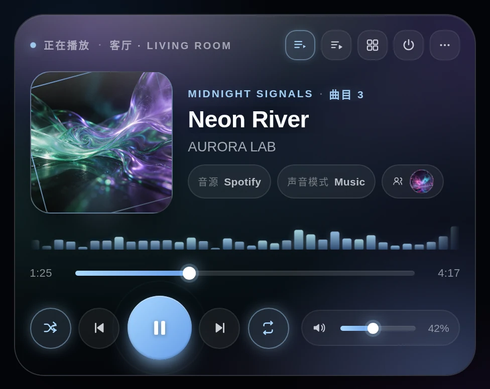
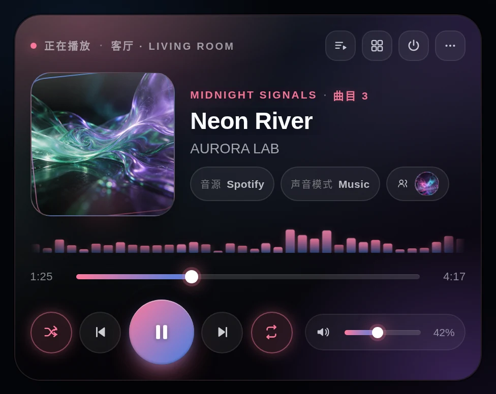
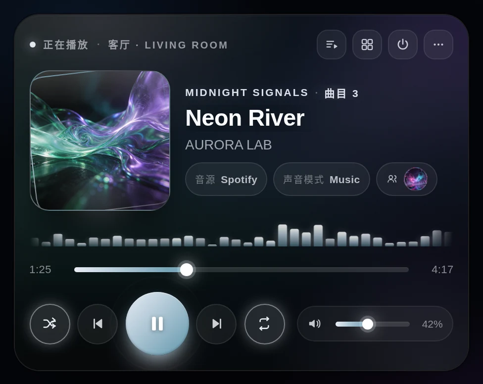
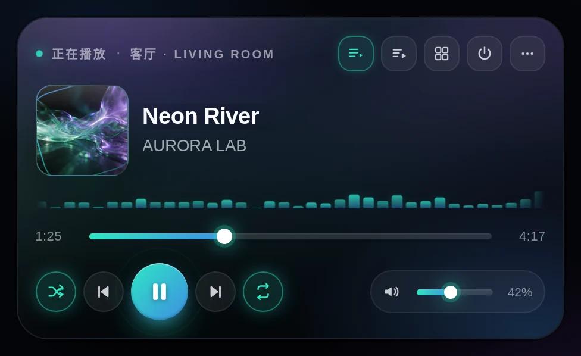
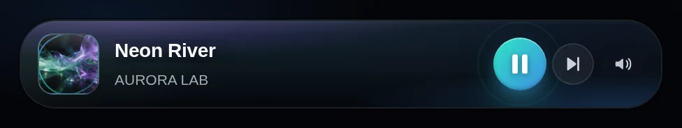
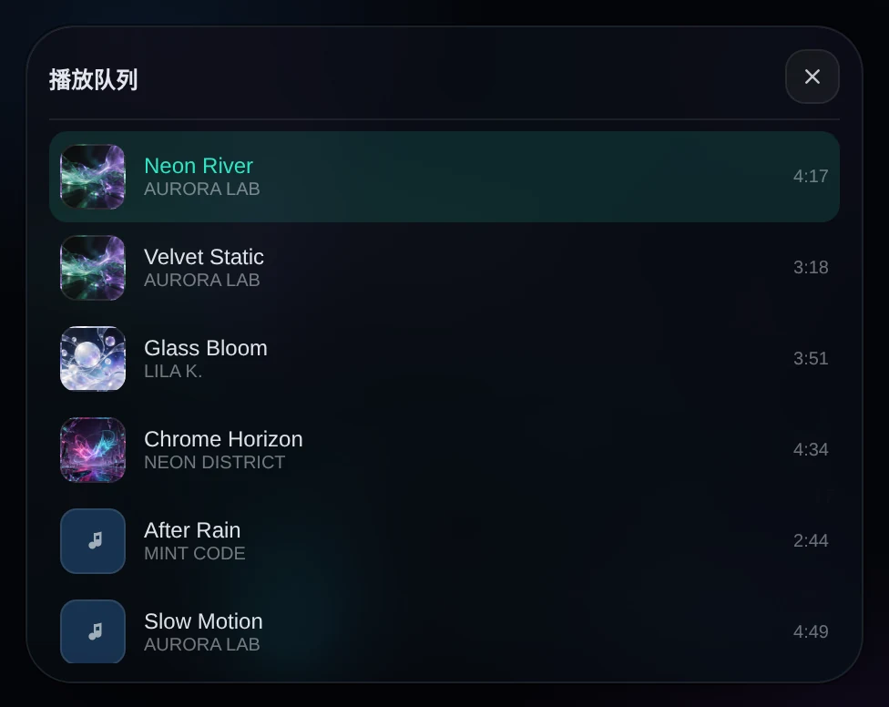
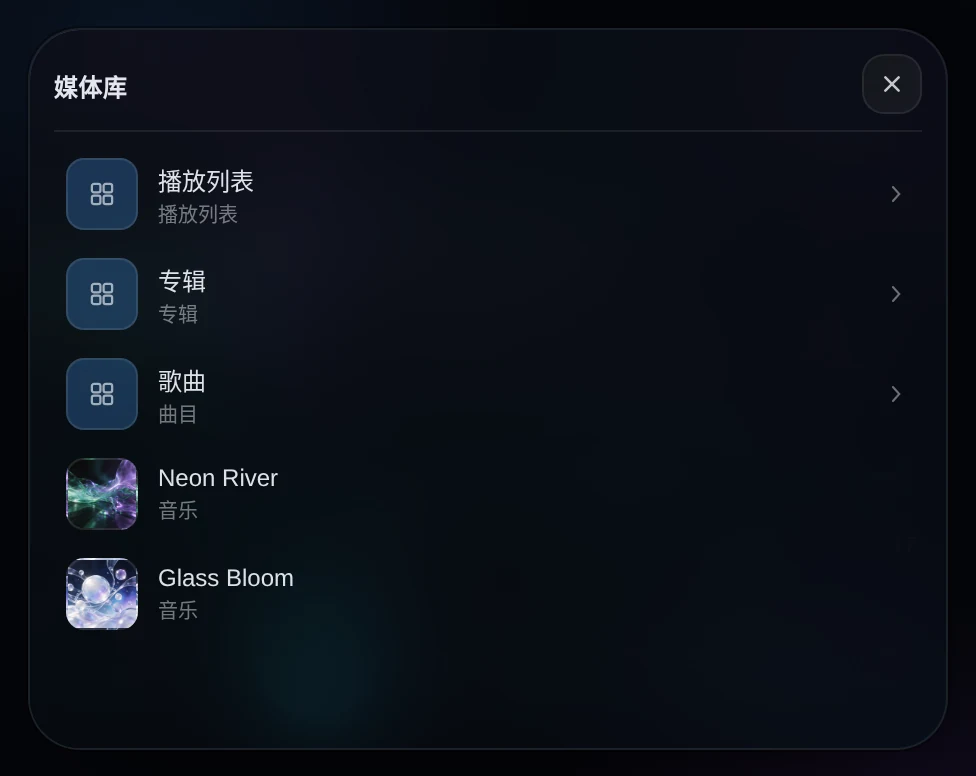
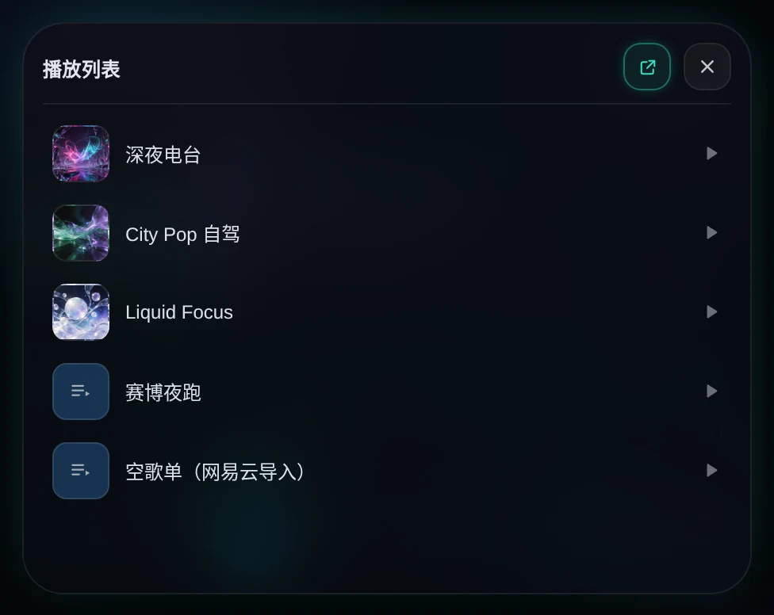

# HA Music

> 为 Home Assistant 打造的高颜值、全功能音乐播放器 Lovelace 卡片。<br>
> 液态玻璃 / 赛博霓虹 / 极光 / 天鹅绒 / 黑白 五套主题，三种自适应布局，从封面取色的动态氛围光。

[](https://github.com/RockJesus/ha-music/releases)
[](https://hacs.xyz)
[](LICENSE)



---

## 特性

- **五套主题**：`aurora` 极光、`cyber` 赛博朋克、`liquid` 液态玻璃、`velvet` 天鹅绒、`mono` 黑白，均可用 `accent` 覆盖主色。
- **三档自适应布局**：`full` 完整、`compact` 紧凑、`mini` 迷你单行；默认 `adaptive` 按卡片宽度自动切换（< 430px 进入 compact）。
- **封面驱动配色**：从当前封面提取主色，混入次色与背景氛围光；跨域或取色失败时回退到主题色。
- **三种背景模式**：`ambient` 环境模糊、`art` 封面铺满、`palette` 纯色彩、`none` 无背景。
- **频谱动效**：`bars` 柱状、`wave` 波形、`orbit` 光环，播放时动、暂停时停。
- **完整播放控制**：播放/暂停、上一首/下一首、进度拖动、音量拖动与静音、随机、循环（关/列表/单曲）、电源开关。
- **音源与声音模式**：读取 `source_list` / `sound_mode_list`，点击 chip 直接切换。
- **播放队列**：读取播放器 `queue` 属性，抽屉内点击任意曲目跳播。
- **媒体库浏览**：走 HA 原生 WebSocket `media_player/browse_media`，支持逐层进入、返回与播放叶子项。
- **多设备切换**：`entities` 列表顶部胶囊切换，同一张卡管理多个 `media_player`。
- **Music Assistant 歌单**：顶栏歌单按钮直接列出 MA 播放列表，点击任意歌单即通过 `music_assistant.play_media` 开播；抽屉右上角仍可跳转 MA 面板。
- **能力自适应**：按 `supported_features` 位掩码显示按钮，不出现无效控件。
- **可视化编辑器**：UI 内直接改布局、主题、背景、频谱、标题、强调色、音量实体与显示开关。
- **无 CDN 依赖**：单文件 ESM，内联全部依赖与图标，离线可用。

## 预览

| 极光 Aurora | 赛博朋克 Cyberpunk |
| --- | --- |
|  |  |

| 液态玻璃 Liquid Glass | 天鹅绒 Velvet | 黑白 Mono |
| --- | --- | --- |
|  |  |  |

| 紧凑布局 | 迷你布局 |
| --- | --- |
|  |  |

| 播放队列 | 媒体库 |
| --- | --- |
|  |  |

| Music Assistant 歌单 |
| --- |
|  |

## 安装

### HACS（推荐）

1. HACS → 右上角菜单 → **Custom repositories**。
2. Repository 填 `https://github.com/RockJesus/ha-music`，Category 选 **Lovelace / Dashboard**，点击 Add。
3. 在 HACS 中搜索 **HA Music** 并下载。
4. 刷新浏览器（必要时清缓存），HACS 会自动注册资源。

### 手动安装

1. 下载 [最新 Release](https://github.com/RockJesus/ha-music/releases/latest) 中的 `ha-music.js`。
2. 放到 `/config/www/ha-music.js`。
3. 设置 → 仪表盘 → 右上角菜单 → 资源，添加：
   - URL：`/local/ha-music.js?v=1.0.3`
   - 类型：JavaScript 模块

## 配置

```yaml
type: custom:ha-music
entity: media_player.living_room
```

| 配置项 | 类型 | 默认 | 说明 |
| --- | --- | --- | --- |
| `entity` | string | — | 单个 `media_player` 实体；与 `entities` 二选一 |
| `entities` | list | — | 多个播放器，卡片顶部显示切换胶囊 |
| `name` | string | 实体名称 | 状态栏显示的播放器名称 |
| `layout` | `adaptive` \| `full` \| `compact` \| `mini` | `adaptive` | 布局；`adaptive` 按宽度自动切换 |
| `theme` | `aurora` \| `cyber` \| `liquid` \| `velvet` \| `mono` | `aurora` | 主题 |
| `accent` | hex color | — | 覆盖主题主色，如 `"#ff5fa2"` |
| `palette` | bool | `true` | 是否从封面取色（`false` 则固定主题色） |
| `cover` | `ambient` \| `art` \| `palette` \| `none` | `ambient` | 背景模式 |
| `visualizer` | `bars` \| `wave` \| `orbit` \| `none` | `bars` | 频谱动效 |
| `volume_entity` | string | — | 用独立实体控制音量（如 `media_player.amplifier`） |
| `show_volume` | bool | `true` | 显示音量条 |
| `show_source` | bool | `true` | 显示音源 chip |
| `show_queue` | bool | `true` | 显示队列按钮（需播放器提供 `queue` 属性） |
| `show_library` | bool | `true` | 显示媒体库按钮（需支持 `BROWSE_MEDIA`） |
| `show_group` | bool | `true` | 显示分组标签与分组成员 |
| `max_queue` | number | `60` | 队列最多展示条数 |
| `music_assistant` | `true` \| `false` \| string | 自动 | 歌单入口：不填时检测到 MA 服务/播放器即显示；`false` 隐藏；字符串同时作为抽屉内「打开 MA」按钮的面板地址（留空自动读 HA 面板路径） |

### 示例

**基础**

```yaml
type: custom:ha-music
entity: media_player.living_room
theme: aurora
```

**液态玻璃 + 封面铺满 + 波形**

```yaml
type: custom:ha-music
entity: media_player.study
theme: liquid
cover: art
visualizer: wave
accent: "#a9d8ff"
```

**多设备 + 迷你布局**

```yaml
type: custom:ha-music
entities:
  - media_player.living_room
  - media_player.bedroom
  - media_player.kitchen
layout: mini
theme: cyber
show_volume: false
```

### Music Assistant

- 顶栏歌单按钮列出 MA 播放列表（走 `media_player/browse_media` 的 `Playlists` 目录），点击后调用 `music_assistant.play_media`（`media_type: playlist`、`enqueue: play`）直接开播。
- 没有 MA 服务时自动回退 `media_player.play_media`，因此普通播放器的歌单也能用。
- 抽屉右上角的跳转图标打开 MA 面板：默认自动读取 HA 面板路径（加载项 ingress 的前缀因实例而异，如 `/b93b5321_music_assistant`），也可用 `music_assistant` 指定相对路径或 `https://` 地址。
- 队列与媒体库浏览仍走实体暴露的 `queue` 与 `browse_media`，无需额外配置。

## 交互说明

- **点击封面 / 右下角菜单** → 打开更多信息（more-info）。
- **进度条**：拖动时显示预览时间，松手后调用 `media_seek`。
- **音量条**：拖动实时调音量，松手调用 `volume_set`；喇叭图标切换静音。
- **音源 / 声音模式 chip**：点击弹出列表，选中即切换。
- **队列抽屉**：点击曲目通过 `media_content_id` / `media_content_type` 播放。
- **媒体库抽屉**：逐层进入，左上角返回上一级。
- **分组标签**：点击即退出当前分组。

## 兼容性

- Home Assistant 2023.8 及以上；不需要任何前端集成或后端组件。
- 队列依赖播放器暴露 `queue` 属性（Music Assistant、Sonos 等支持）。
- 媒体库依赖播放器支持 `BROWSE_MEDIA`，部分集成可能只返回扁平列表。
- 音量默认作用于当前播放器，可用 `volume_entity` 指向功放/音箱实体。

## 开发

```bash
cd card-src
npm install
npm test      # 工具函数单元测试
npm run build # 输出 ../ha-music.js
```

预览页面 `preview/preview.html` 内置伪 hass / 队列 / 媒体库，可脱离 HA 直接查看效果：

```bash
python3 -m http.server 8765
# http://localhost:8765/preview/preview.html?theme=cyber&layout=full&w=460
```

## 更新日志

### 1.0.3

- 顶栏 `MA` 跳转按钮改为 **Music Assistant 歌单选择器**：列出播放列表，点击即开播（`music_assistant.play_media`）。
- 非 MA 播放器自动回退到 `media_player.play_media`。
- 抽屉右上角保留「打开 MA 面板」快捷入口，面板路径仍自动读取。
- 歌单抽屉新增封面/无封面占位、空列表与错误提示。

### 1.0.2

- 自动从 `hass.panels` 定位 Music Assistant 面板路径，兼容加载项 ingress 的随机前缀，不再依赖固定 `/music-assistant`。
- 保留 `music_assistant` 自定义路径/`false` 关闭的能力。

### 1.0.1

- 新增 Music Assistant 入口：自动识别 MA 播放器，顶栏 `MA` 徽标一键跳转 MA 面板。
- 支持 `music_assistant: true / false / "自定义地址"`，兼容加载项 ingress 路径与外部地址。
- 编辑器新增入口开关与地址输入。
- 预览截图同步刷新。

### 1.0.0

- 首个版本：五主题、三布局、封面取色、三种频谱、队列与媒体库抽屉、多设备切换、可视化编辑器。

## License

[MIT](LICENSE)
