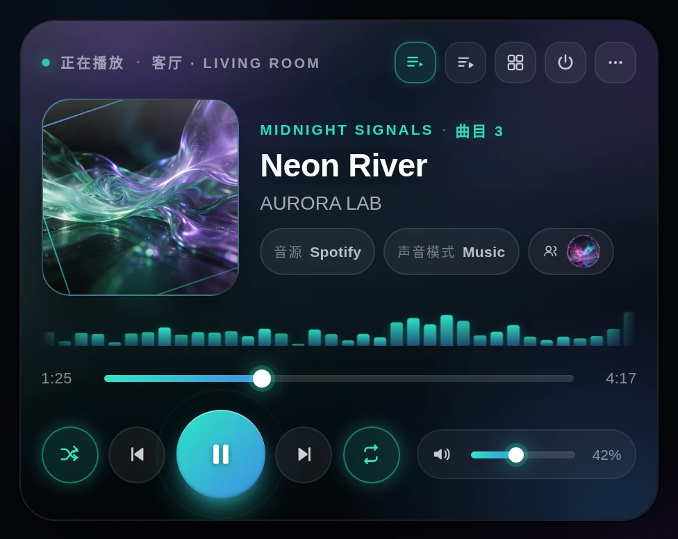
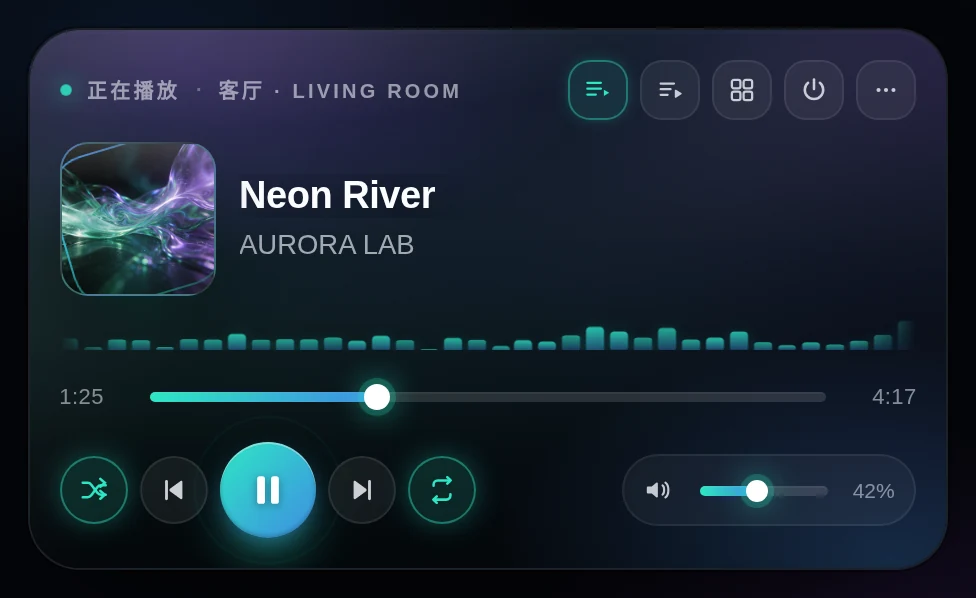
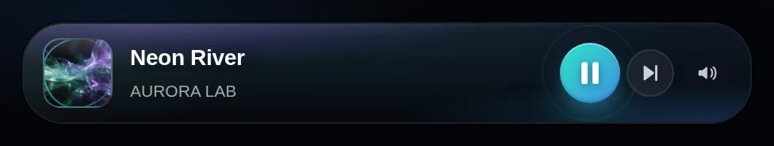
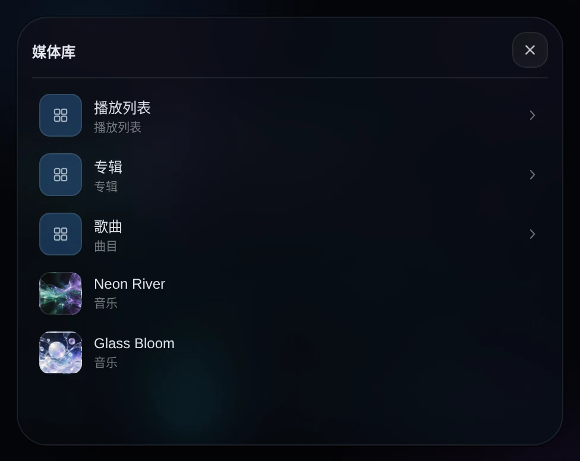
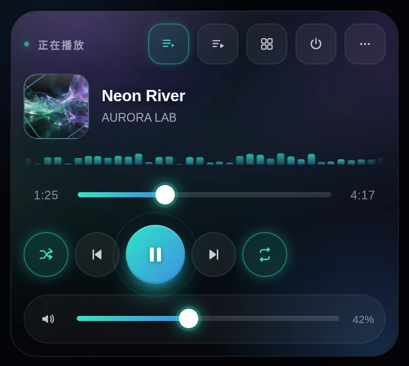
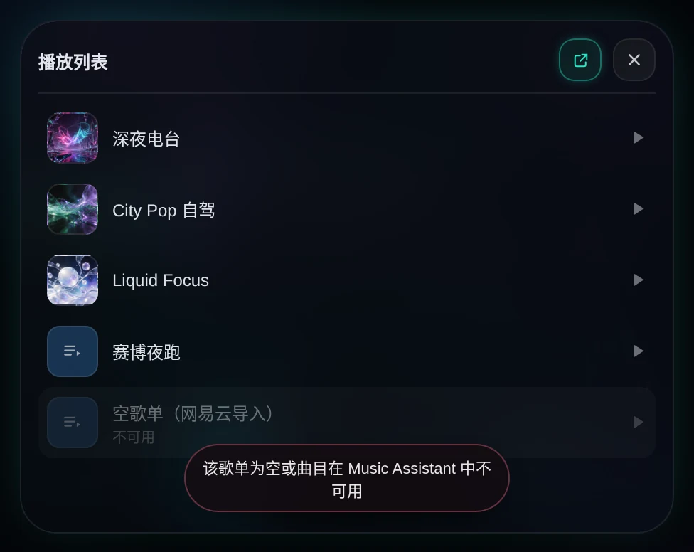

# HA Music

> 为 Home Assistant 打造的高颜值、全功能音乐播放器 Lovelace 卡片。<br>
> 液态玻璃 / 赛博霓虹 / 极光 / 天鹅绒 / 黑白 / 日落 / 海洋 七套主题，三种自适应布局，从封面取色的动态氛围光。

[](https://github.com/RockJesus/ha-music/releases)
[](https://hacs.xyz)
[](LICENSE)



---

## 特性

- **全局统一**：顶部、侧边栏、右下角三个迷你播放器的开关、实体和主题写入同一份浏览器 localStorage，同一页面多张卡片实时广播同步，在 `test`、`music` 等不同视图/仪表盘之间也保持同一组配置。
- **七套主题**：`aurora` 极光、`cyber` 赛博朋克、`liquid` 液态玻璃、`velvet` 天鹅绒、`mono` 黑白、`sunset` 日落、`ocean` 海洋；顶部、侧边栏、右下角三个迷你播放器可分别选择主题。
- **栅格自适应**：实现 `getGridOptions()` / `getLayoutOptions()`，支持 sections 视图调整列数与行数（最低 4 列×2 行）；卡片高度跟随网格行高填满，不再出现下方空白。
- **宽高双维自适应**：除宽度外同时检测卡片可用高度，矮格子自动降到 mini 单行、低矮中等格子用 compact，避免封面/标题/控制条被裁切。
- **元素不互相遮盖**：封面尺寸随可用高度计算，控制区强制单行、不再让音量换行；紧凑矮卡片自动隐藏频谱和封面光晕，保证标题、进度、控制条各占独立区域。
- **卡片选择器缩略预览**：兼容旧 `hui-card-preview` 与 HA 2026.6 的 `hui-suggestion-card` / `hui-card[preview]`，在预览容器内使用独立的参考图 UI——圆角方形封面、大标题、频谱、进度条和完整控制条；按预览尺寸分 lg / md / sm 三档。
- **真实能量律动**：柱状频谱优先读取 Home Assistant `ha_music_analysis.get_track_analysis` 桥接服务返回的 Music Assistant 1800 点 RMS 能量波形，按当前播放进度取约 2.8 秒窗口映射为 36 根柱，并结合 BPM / 节拍相位与能量上升沿做低频 kick 注入；暂停自动降到低幅。没有桥接服务时自动回退到逐帧程序化律动。频谱是真实能量起伏，不是频段拆分后的 FFT 频谱。
- **封面手势**：单击封面播放/暂停；左滑封面切下一首，右滑切上一首；滑动带跟手回弹与方向动效，单击带按压缩放反馈。
- **触控友好控件**：播放/上一首/下一首/随机/循环按钮与音量条整体加大，音量滑轨加粗到 13px、触屏 16px，音量图标和滑块拇指同步放大；窄屏和手机面板自动把控制区拆成「按钮 + 音量」两行，避免手指误触或被裁切。
- **全局歌词悬浮窗**：默认开启，默认停在顶栏内；只显示当前播放歌曲的一句歌词，透明背景、无胶囊外框，歌词文字使用当前主题渐变；长按可拖动并跨页面记住位置。默认自动跟随当前正在播放的播放器，即使当前页面没有 `ha-music` 卡片，也能自动匹配歌词。
- **自动歌词**：优先复用 `knoop7/lyrics-card` 的 `netease_lyrics` 同源接口 `/api/netease_lyrics/lyrics`（按 QQ 音乐、网易云顺序搜索，可选）；后端集成未安装、未加载或返回 404 时，自动回退到 LRCLIB 在线同步歌词，最后用 Lyrics.ovh 纯文本歌词兜底，无需额外配置。支持 LRC 时间轴同步高亮与点击歌词跳转，卡片显示当前一句，点顶栏「歌词」按钮进入滚动歌词面板；纯文本歌词同样支持。编辑器「歌词源」可选 `自动（QQ/网易云 → LRCLIB → Lyrics.ovh）`、`QQ 音乐`、`网易云音乐`、`LRCLIB（在线同步歌词）`，默认自动；也可整体关闭歌词。
- **歌词补强**：当前句跟随播放进度做逐行卡拉OK填充；歌词面板内置 ±0.5 秒时间偏移，歌词提前/滞后可即时校准；常用歌词缓存到浏览器本地，切歌/重载后优先复用。前端按参考项目清洗 `(Live)`、`[Remix]`、括号说明与分隔符，再依次尝试「清洗歌名 + 歌手」「清洗歌名」「原始歌名 + 歌手」；LRCLIB 额外按歌名、歌手、时长投票挑选最可信的版本，避免现场版/翻唱带偏时间轴；接口请求带 HA 访问令牌，401 自动刷新令牌并重试。
- **三档自适应布局**：`full` 完整、`compact` 紧凑、`mini` 迷你单行；默认 `adaptive` 按卡片宽度自动切换（< 430px 进入 compact）。
- **封面驱动配色**：从当前封面提取主色，混入次色与背景氛围光；跨域或取色失败时回退到主题色。
- **面板单屏铺满**：面板视图按可用高度约束圆形封面，自动压缩主区，频谱、进度和控制条保持在单屏内，不产生纵向溢出；面板中卡片四角保留与普通卡片一致的圆角，不再是无圆角的直角铺满。
- **圆形旋转封面**：主卡片和全局迷你播放器的歌曲封面统一为圆形；播放时顺时针旋转，暂停时平滑回正。
- **无封面默认图**：播放器不可用、曲目无封面或封面加载失败时，主卡片与三个迷你播放器统一显示主题化默认唱片封面，不再出现空白/broken image。
- **三种背景模式**：`ambient` 环境模糊、`art` 封面铺满、`palette` 纯色彩、`none` 无背景。
- **频谱动效**：`bars` 柱状、`wave` 波形、`orbit` 光环；`bars` 优先使用 MA 能量波形，未接桥接服务时按「歌名+歌手+专辑」和 `media_position` 做逐帧律动。
- **完整播放控制**：播放/暂停、上一首/下一首、进度拖动、音量拖动与静音、随机、循环（关/列表/单曲）、电源开关。
- **音源与声音模式**：读取 `source_list` / `sound_mode_list`，点击 chip 直接切换。
- **当前播放列表**：原生播放器读取 `queue` 属性；Music Assistant 播放器经 HA Supervisor Ingress 直连 MA API 读取完整队列，抽屉内点击任意曲目精确切歌，无需安装 Mass Queue。非管理员、外部 MA 服务器或读取失败时，自动回退到当前/下一首，并保留「在 Music Assistant 查看全部」入口。
- **媒体库浏览**：走 HA 原生 WebSocket `media_player/browse_media`，支持逐层进入、返回与播放叶子项。
- **多设备切换**：`entities` 列表顶部胶囊切换，同一张卡管理多个 `media_player`；首次加载或有播放器刚开始播放时，会自动跟到正在播放的那台，多台同时播放则优先最近更新的一台。手动点选播放器后不会被立刻抢回，避免影响操作。
- **触屏优先**：`pointer: coarse` 下按钮/滑杆/列表自动放大到 40–48px，抽屉滚动不穿透页面，点按有按压反馈；窄屏自动把音量条换到下一行，避免大按钮把卡片撑破。
- **Music Assistant 歌单**：开启「MA 歌单入口」后顶栏按钮始终显示；当前播放器是 MA 播放器时列出 MA 播放列表，点击任意歌单即通过 `music_assistant.play_media` 开播；普通播放器点击会直接打开 MA 面板，不再只弹提示或发出无效请求；抽屉右上角仍可跳转 MA 面板。
- **能力自适应**：按 `supported_features` 位掩码显示按钮，不出现无效控件。
- **可视化编辑器**：UI 内直接改布局、主题、背景、频谱、标题、强调色、音量实体与显示开关。
- **无 CDN 依赖**：单文件 ESM，内联全部依赖与图标，离线可用。

## 预览

| 极光 Aurora | 赛博朋克 Cyberpunk |
| --- | --- |
|  |  |

| 液态玻璃 Liquid Glass | 天鹅绒 Velvet | 黑白 Mono |
| --- | --- | --- |
|  |  |  |

| 紧凑布局 | 迷你布局 |
| --- | --- |
|  |  |

| 播放队列 | 媒体库 |
| --- | --- |
|  |  |

| 手机触屏（完整） | 手机触屏（紧凑 / 迷你） |
| --- | --- |
|  |  |

| Music Assistant 歌单 | 空歌单提示 |
| --- | --- |
|  |  |

## 安装

### 前置：歌词后端（可选）

卡片不依赖歌词后端即可使用：自动模式会先尝试 `knoop7/lyrics-card` 的 `netease_lyrics` 接口，未安装时自动回退 LRCLIB，再用 Lyrics.ovh 纯文本歌词兜底。若希望优先使用 QQ 音乐 / 网易云音乐歌词，可在 HACS 中安装 **Lyrics** 集成（`knoop7/lyrics-card`，类别选 Integration）；不安装也不影响自动歌词与全局悬浮歌词。

### HACS（推荐）

1. HACS → 右上角菜单 → **Custom repositories**。
2. Repository 填 `https://github.com/RockJesus/ha-music`，Category 选 **Lovelace / Dashboard**，点击 Add。
3. 在 HACS 中搜索 **HA Music** 并下载。
4. 刷新浏览器（必要时清缓存），HACS 会自动注册资源。

### 手动安装

1. 下载 [最新 Release](https://github.com/RockJesus/ha-music/releases/latest) 中的 `ha-music.js`。
2. 放到 `/config/www/ha-music.js`。
3. 设置 → 仪表盘 → 右上角菜单 → 资源，添加：
   - URL：`/local/ha-music.js?v=2.2.2`
   - 类型：JavaScript 模块

## 配置

```yaml
type: custom:ha-music
entity: media_player.living_room
```

| 配置项 | 类型 | 默认 | 说明 |
| --- | --- | --- | --- |
| `entity` | string | — | 单个 `media_player` 实体；与 `entities` 二选一 |
| `entities` | list | — | 多个播放器，卡片顶部显示切换胶囊 |
| `name` | string | 实体名称 | 状态栏显示的播放器名称 |
| `layout` | `adaptive` \| `full` \| `compact` \| `mini` | `adaptive` | 布局；`adaptive` 按宽度自动切换 |
| `theme` | `aurora` \| `cyber` \| `liquid` \| `velvet` \| `mono` \| `sunset` \| `ocean` | `cyber` | 主卡片主题 |
| `accent` | hex color | — | 覆盖主题主色，如 `"#ff5fa2"` |
| `palette` | bool | `true` | 是否从封面取色（`false` 则固定主题色） |
| `cover` | `ambient` \| `art` \| `palette` \| `none` | `ambient` | 背景模式 |
| `visualizer` | `bars` \| `wave` \| `orbit` \| `none` | `bars` | 频谱动效；`bars` 为实时频谱，`wave` 为波形，`orbit` 为光环 |
| `volume_entity` | string | — | 用独立实体控制音量（如 `media_player.amplifier`） |
| `show_volume` | bool | `true` | 显示音量条 |
| `show_lyrics` | bool | `true` | 自动识别并显示歌词；关闭后不请求歌词接口 |
| `floating_lyrics` | bool | `true` | 全局歌词悬浮窗：默认开启并停在顶栏，只显示当前一句；透明背景、无胶囊，文字主题渐变；长按拖动并跨页面记住位置 |
| `floating_lyrics_auto` | bool | `true` | 全局歌词自动跟随正在播放的播放器；即使当前页面没有卡片也会自动匹配歌词 |
| `mobile_hide_dock` | bool | `true` | 手机端自动隐藏悬浮播放器；仅粗指针窄屏/横屏矮屏生效，桌面和平板不受影响 |
| `mobile_hide_lyrics` | bool | `true` | 手机端自动隐藏全局歌词悬浮窗；仅粗指针窄屏/横屏矮屏生效，桌面和平板不受影响 |
| `show_source` | bool | `true` | 显示音源 chip |
| `show_queue` | bool | `true` | 显示当前播放列表按钮；MA 播放器自动读取完整队列（需 Music Assistant 加载项）；读取失败时回退当前/下一首 |
| `show_library` | bool | `true` | 显示媒体库按钮（需支持 `BROWSE_MEDIA`） |
| `show_group` | bool | `true` | 显示分组标签与分组成员 |
| `dock` | `none` \| 位置数组 | `none` | 全局迷你播放器位置，可同时启用多个：`top` / `sidebar` / `fab`；直接控制播放暂停、上一首、下一首，不跳转页面 |
| `dock_entities` | object | — | 每个位置各自的播放器实体，如 `{ top: "media_player.a", sidebar: "media_player.b", fab: "media_player.c" }`；未填时回退主卡片实体 |
| `dock_themes` | object | — | 每个位置各自的播放器主题，如 `{ top: "cyber", sidebar: "liquid", fab: "velvet" }`；未填时跟随主卡片 `theme` |
| `max_queue` | number | `60` | 原生播放器/MA 兜底队列最多展示条数；MA 完整队列显示全部 |
| `music_assistant` | `true` \| `false` \| string | 自动 | 歌单入口：不填时检测到 MA 服务/播放器即显示；`false` 隐藏；字符串同时作为抽屉内「打开 MA」按钮的面板地址（留空自动读 HA 面板路径） |

### MA 真实能量波形

卡片不再要求填写歌曲音频直链或歌单。接入 Home Assistant 的 `ha_music_analysis` 桥接服务后，卡片会在播放时自动调用 `ha_music_analysis.get_track_analysis`，读取当前曲目的 Music Assistant 分析结果：

- `waveform`：1800 点 0–1 RMS 能量波形，均匀覆盖整首曲目
- `bpm` / `bpm_source`：节拍速度与来源
- `energy` / `duration`：整体能量、曲目时长

频谱柱按当前 `media_position` 在波形上滑动取窗，因此会跟随真实播放进度起伏，而不是固定动画；暂停后柱高自动回落。桥接服务不可用、当前曲目没有分析结果或实体不是 MA 播放器时，卡片自动回退到程序化逐帧律动，不报错、不影响播放。

> 这是能量轮廓 + 节拍相位，不是按频段拆分的实时 FFT 频谱。桥接服务 `ha_music_analysis` 需要单独安装到 HA；未安装时卡片使用内置律动。

### 全局迷你播放器

在任意 `ha-music` 卡片的可视化编辑器里，**顶部播放器 / 侧边栏播放器 / 右下角播放器** 可以同时启用，也可以分别选择各自的播放器实体。不是跳转按钮，播放/暂停、上一首、下一首会直接调用对应 `media_player` 的服务。

- **顶部**：嵌入 HA 顶栏，高度随顶栏自适应；宽度在桌面/手机自动收敛，**默认在顶栏「+」按钮左侧**，长按后**只允许左右移动**，并始终夹在顶栏内。
- **侧边栏**：宽度贴合当前侧栏宽度；**默认在侧边栏「设置」入口上方**，长按后**只允许上下移动**，X 固定在侧栏内，不进入主内容区；侧栏折叠时自动缩成紧凑圆盘。
- **右下角**：**默认在屏幕右侧垂直居中**的圆形唱片；长按约 0.36 秒后可**任意拖动**，但位置会被约束在主内容区，不能进入顶部导航栏或侧边栏。点击展开为玻璃面板，显示封面模糊背景、曲目信息、进度和播放控制。收起态外圈带 **36 根镜像音频律动柱**（12 点低频紫、6 点高频青），随歌曲元数据与 `media_position` 起伏，并叠加唱片脉冲与紫色辉光；暂停或展开时淡出。参考公开的唱片环形律动实现，按低频/高频分布 36 根镜像柱。
- **交互**：单击任意非按钮区域切换播放/暂停；双击折叠或展开；顶部/侧边栏/右下角都支持长按约 0.36 秒后拖动位置，其中顶部只左右、侧边栏只上下、右下角可任意拖动但避开顶栏与侧栏。顶部/侧边栏双击折叠成小圆盘，右下角双击展开或收起玻璃面板；上一首、下一首、音量等按钮仍保留各自动作。
- 卡片渲染一次后，位置、当前播放器实体和拖动坐标记入浏览器 `localStorage`；之后打开其他仪表盘会自动恢复，不需要每个页面都放卡。
- 也可以直接用资源 URL 指定：`&dock=top,fab&dock_entity_top=media_player.a&dock_entity_fab=media_player.b&dock_theme_top=cyber&dock_theme_fab=velvet`；`dock` 可选 `top` / `sidebar` / `fab`，多个用逗号分隔。
- 编辑器里每个已启用的位置都有独立「播放器主题」下拉，可选 `aurora` / `cyber` / `liquid` / `velvet` / `mono` / `sunset` / `ocean`；未显式选择时跟随主卡片主题。
- 关闭：在编辑器里取消对应位置的勾选；全部关闭即移除全局播放器。
- 同一个 `ha-music.js` 既可作为 Lovelace 资源，也可作为全局模块加载；内部已防止重复 `customElements.define`。
- 需要设置页等非仪表盘页面也加载时，再把模块地址加入 `frontend.extra_module_url`（可选）。

### 面板自适应

当卡片放在 HA 的面板视图（view `type: panel`）里时，会自动检测 `hui-panel-view` 并铺满面板可用宽高；普通 masonry/sections 视图仍按卡片内容高度渲染。

### 示例

**基础**

```yaml
type: custom:ha-music
entity: media_player.living_room
theme: cyber
```

**液态玻璃 + 封面铺满 + 波形**

```yaml
type: custom:ha-music
entity: media_player.study
theme: liquid
cover: art
visualizer: wave
accent: "#a9d8ff"
```

**多设备 + 迷你布局**

```yaml
type: custom:ha-music
entities:
  - media_player.living_room
  - media_player.bedroom
  - media_player.kitchen
layout: mini
theme: cyber
show_volume: false
```

### Music Assistant

- 顶栏歌单按钮列出 MA 播放列表（走 `media_player/browse_media` 的 `Playlists` 目录），点击后调用 `music_assistant.play_media`（`media_type: playlist`、`enqueue: play`）直接开播。
- 没有 MA 服务时自动回退 `media_player.play_media`，因此普通播放器的歌单也能用。
- 抽屉右上角的跳转图标打开 MA 面板：默认自动读取 HA 面板路径（加载项 ingress 的前缀因实例而异，如 `/b93b5321_music_assistant`），也可用 `music_assistant` 指定相对路径或 `https://` 地址。
- 完整队列优先经 HA Supervisor Ingress 直连 MA 的 `player_queues/items`，支持 3000+ 首并在抽屉内精确切歌；没有 MA 加载项、当前用户不是管理员或 Ingress 不可用时，回退到 `music_assistant.get_queue` 的当前/下一首与 `mass_queue`（若已安装）。

## 交互说明

- **单击封面** → 播放 / 暂停；**左滑封面** → 下一首；**右滑封面** → 上一首。
- **右上角 `...` / 右下角菜单** → 打开更多信息（more-info）。
- **进度条**：拖动时显示预览时间，松手后调用 `media_seek`。
- **音量条**：拖动实时调音量，松手调用 `volume_set`；喇叭图标切换静音。
- **音源 / 声音模式 chip**：点击弹出列表，选中即切换。
- **队列抽屉**：点击曲目通过 `media_content_id` / `media_content_type` 播放。
- **媒体库抽屉**：逐层进入，左上角返回上一级。
- **分组标签**：点击即退出当前分组。

## 兼容性

- Home Assistant 2023.8 及以上；不需要任何前端集成或后端组件。
- 原生队列依赖播放器暴露 `queue` 属性（Sonos 等支持）；Music Assistant 完整队列依赖 MA 加载项的 Ingress，无需 mass_queue。
- 媒体库依赖播放器支持 `BROWSE_MEDIA`，部分集成可能只返回扁平列表。
- 音量默认作用于当前播放器，可用 `volume_entity` 指向功放/音箱实体。

## 开发

```bash
cd card-src
npm install
npm test      # 工具函数单元测试
npm run build # 输出 ../ha-music.js
```

### 全局歌词悬浮窗

「全局歌词悬浮窗」默认开启，首次显示时位于顶栏内；也可以在编辑器中关闭：

- 只显示当前播放歌曲的当前一句，不展开完整歌词；
- 透明背景、无胶囊边框，歌词文字使用当前主题的渐变颜色；
- 默认位置在顶栏内，长按约 360ms 后可拖动，位置写入浏览器 localStorage，跨页面保留；
- 与三个全局迷你播放器一样，开关状态全局记忆，任意仪表盘中关闭后不会被旧卡片重新打开。

预览页面 `preview/preview.html` 内置伪 hass / 队列 / 媒体库，可脱离 HA 直接查看效果：

```bash
python3 -m http.server 8765
# http://localhost:8765/preview/preview.html?theme=cyber&layout=full&w=460
```

## 变更记录

版本变更与发布说明统一见 [GitHub Releases](https://github.com/RockJesus/ha-music/releases)。
